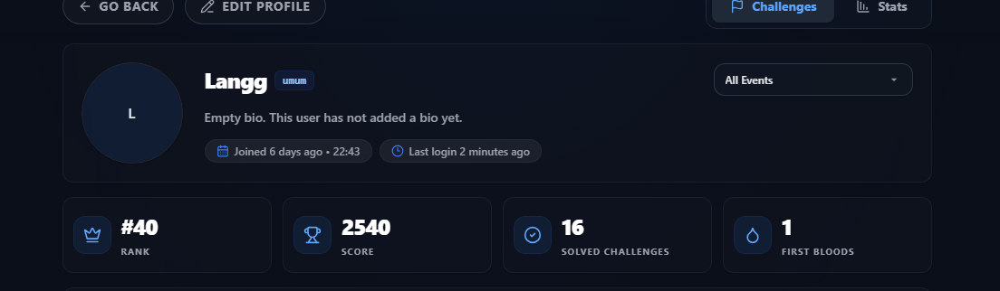
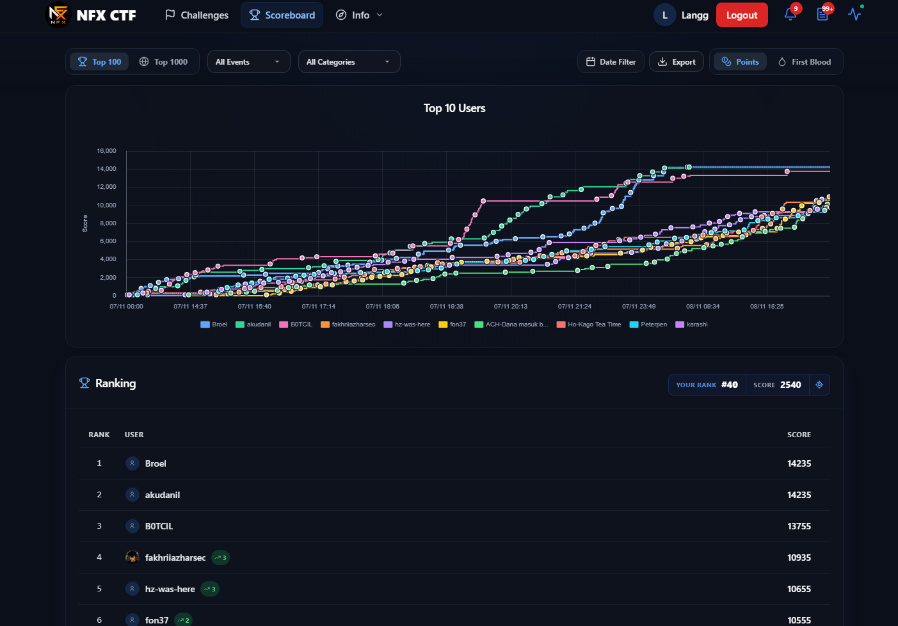

# NFX CTF 2026 — Personal Write-Ups

Ini kumpulan catatan aku waktu ngerjain **NFX CTF 2026**. Aku tulis dari awal: petunjuk yang aku dapet, cara aku nyari celah atau informasi, percobaan yang berhasil maupun gagal, sampai hasil flag-nya. Jadi ini memang alur pengerjaan aku sendiri, bukan cerita dari sudut pandang orang lain.

## Identitas peserta

| Kolom | Informasi |
| --- | --- |
| Nama | **I Putu Gilang Permana Kusuma** |
| Username pada ctf.nfx.my.id | **Langg** |
| Track pada profil | **Umum** |
| Status dokumentasi | **15 write-up tersedia dari 16 challenge solved** |

## Hasil kompetisi — berdasarkan screenshot profil & scoreboard 10 November 2026

| Indikator | Angka yang terlihat |
| --- | ---: |
| Ranking pengguna pada tampilan scoreboard *All Events* | **#40** |
| Skor akun yang ditampilkan | **2.540** |
| Solved challenges | **16** |
| First bloods | **1** |

> **Catatan skor:** Di screenshot akun aku tertulis **2.540 poin** dengan peringkat **#40**. Itu angka yang aku pakai di laporan, bukan hasil menjumlahkan poin setiap soal. Scoreboard-nya masih difilter **All Events / All Categories**, jadi aku belum menyebut #40 sebagai peringkat akhir khusus Track Umum. Profil sudah menunjukkan **16 solved**, sementara yang berhasil aku dokumentasikan sekarang baru **15 challenge**. Satu challenge sisanya belum ketemu catatan lengkapnya.

## Daftar 15 write-up

| No. | Challenge | Category | Difficulty | Poin pada profil challenge |
| ---: | --- | --- | --- | ---: |
| 01 | [Notulen Senin Pagi](writeups/01-notulen-senin-pagi.md) | Misc | Baby | 280 |
| 02 | [Pipeline Phantom](writeups/02-pipeline-phantom.md) | Misc | Easy | 480 |
| 03 | [Titipan Akhir Tahun](writeups/03-titipan-akhir-tahun.md) | Misc | Easy | 360 |
| 04 | [Frekuensi Sunyi](writeups/04-frekuensi-sunyi.md) | Misc | Medium | 460 |
| 05 | [Matryoshka Encoding](writeups/05-matryoshka-encoding.md) | Misc | Easy | 460 |
| 06 | [Fresh Arrival](writeups/06-fresh-arrival.md) | OSINT | Medium | 440 |
| 07 | [THE FORGOTTEN STATE](writeups/07-the-forgotten-state.md) | Pwn | Hard | 360 |
| 08 | [Bluebird Session](writeups/08-bluebird-session.md) | Forensics | Hard | 440 |
| 09 | [Access Remains](writeups/09-access-remains.md) | Forensics | Hard | 400 |
| 10 | [SymHell](writeups/10-symhell.md) | Misc | Medium | 400 |
| 11 | [My Lovely Freya](writeups/11-my-lovely-freya.md) | Misc | Hard | 380 |
| 12 | [Stay](writeups/12-stay.md) | Misc | Medium | 380 |
| 13 | [Tragedi 9/11](writeups/13-tragedi-9-11.md) | OSINT | Hard | 400 |
| 14 | [NarrowGate](writeups/14-narrowgate.md) | Pwn | Insane | 420 |
| 15 | [The Alchemist's Sandbox](writeups/15-the-alchemists-sandbox.md) | Misc | Medium | 320 |

*Kolom poin di atas berasal dari label poin tiap challenge; tidak boleh ditafsirkan sebagai total skor scoreboard.*

## Bukti identitas dan posisi

Aku simpan tiga screenshot asli yang aku ambil tanggal **10 November 2026**: profil, scoreboard, dan pedoman write-up. Angka dan identitas di gambarnya tidak aku ubah.

**Profil peserta — username Langg, track umum, rank #40, 2.540 skor, 16 solved, 1 first blood.**

**Scoreboard — posisi #40 dan 2.540 poin pada filter All Events.**

**Pedoman penulisan:** [lihat screenshot guidebook](screenshots/guidebook-writeup-2026-11-10.png).

Scoreboard yang aku screenshot masih di mode `All Events` dan `All Categories`. Jadi angka peringkat yang aku cantumkan memang berdasarkan tampilan itu, belum khusus leaderboard Track Umum.

## Susunan dan metode penulisan

Aku bikin setiap write-up dengan urutan **Challenge Information → Description → Analysis → Solution → Flag → Conclusion**. Bagian solution aku susun sesuai langkah yang aku kerjain, lengkap dengan command atau potongan script yang masih aku simpan.

Beberapa challenge punya hasil decode atau bacaan gambar, tetapi aku tidak punya screenshot submit per flag. Itu aku tulis apa adanya supaya tidak keliru mengklaim hasil. **Khusus SymHell, aku sudah solve challenge-nya, cuma lupa menyimpan flag terakhirnya.** Jadi aku cantumkan catatan tersebut di halaman SymHell, bukan menebak string flag.

## Script reproduksi

- [solve_frekuensi_sunyi.py](scripts/solve_frekuensi_sunyi.py) — STFT, pemrosesan spectrogram, ROT13.
- [solve_matryoshka.py](scripts/solve_matryoshka.py) — byte swapping, Base64, zlib, Base85, XOR.
- [solve_stay.py](scripts/solve_stay.py) — zero-width Unicode, Base64, XOR.
- [solve_forgotten_state.py](scripts/solve_forgotten_state.py) — heap UAF dan GOT overwrite.
- [solve_narrowgate.py](scripts/solve_narrowgate.py) — format-string leak, integer truncation, ORW ROP.
- [alchemist_solve.py](scripts/alchemist_solve.py) — Python AST jail bypass dan pembalikan vault encryption.

Aku tidak mengunggah ulang file soal yang belum jelas izin redistribusinya. Kalau mau menjalankan ulang solver, perlu attachment aslinya. Script yang ada juga tidak semuanya aku jalankan ulang saat repo ini diperbarui.

## Kesesuaian dengan pedoman write-up

Aku mengikuti [pedoman NFX CTF 2026](https://nfx.my.id/guidebook) untuk bagian laporan yang wajib:
1. **Identitas peserta** — nama dan username aku ada di awal README.
2. **Screenshot scoreboard** — aku simpan [screenshot asli](screenshots/README.md) dari profil dan halaman ranking.
3. **Deskripsi serta langkah penyelesaian** — aku tulis di masing-masing challenge, dari awal sampai dapat hasilnya.
4. **String flag** — aku cantumkan sesuai hasil yang masih aku punya. Untuk **SymHell**, aku lupa mencatat flagnya setelah solve, jadi bagian tersebut berisi keterangan, bukan flag asal-asalan.

**Batas pengumpulan:** **13 November 2026 pukul 23.59 WIB**.

**Yang masih kurang:** profil aku menunjukkan 16 solved, tetapi saat ini baru 15 write-up yang sudah tersusun.
