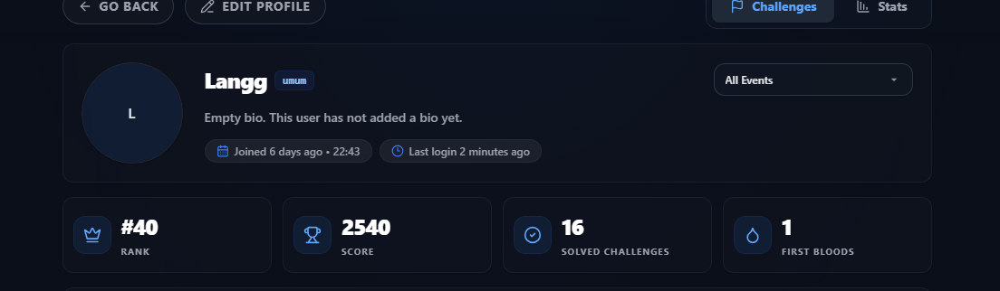
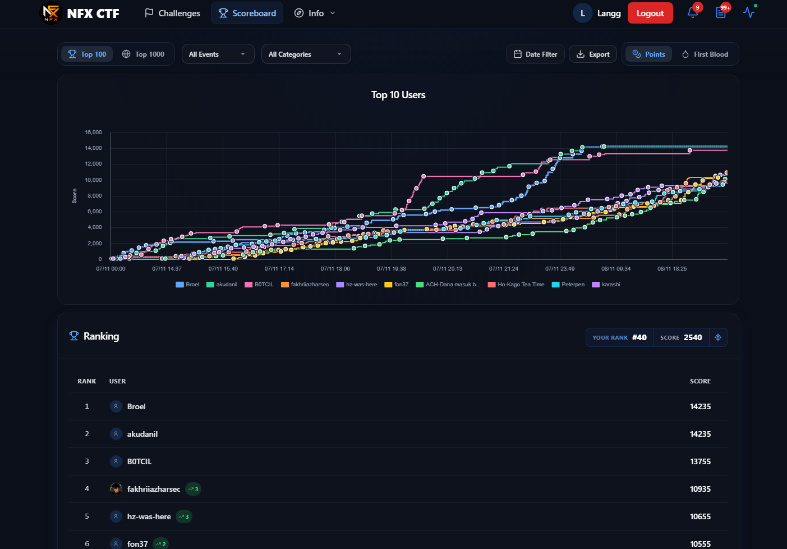
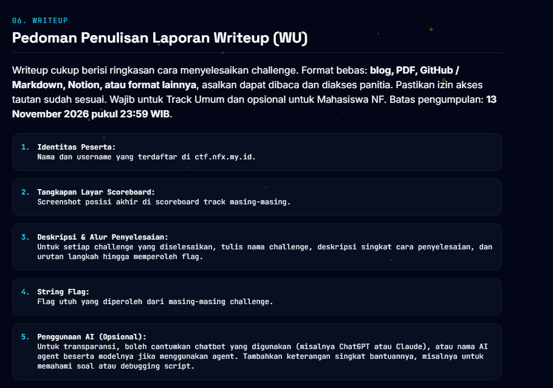

# Ringkasan Pengumpulan Write-up NFX CTF 2026

**Nama:** I Putu Gilang Permana Kusuma  
**Username CTF:** `Langg`  
**Track:** Umum  
**Repository:** https://github.com/Skyreaaa/nfx-ctf-2026-writeups-clean

## Hasil di profil dan scoreboard

Ini hasil yang muncul waktu aku ambil screenshot tanggal **10 November 2026**:

| Informasi | Hasil |
| --- | ---: |
| Peringkat di scoreboard All Events | **#40** |
| Score | **2.540** |
| Solved challenges | **16** |
| First bloods | **1** |

Angka #40 ini berdasarkan tampilan **All Events**, bukan hasil khusus Track Umum. Aku tidak mengubah angka atau tampilan screenshot aslinya.

## Screenshot

**Profil akun aku:**

**Scoreboard waktu aku cek:**

**Pedoman write-up dari panitia:**

## Isi laporan

Sekarang ada **15 write-up** yang sudah aku susun di folder [writeups](writeups/). Masing-masing menjelaskan apa yang aku cek, kenapa aku pakai cara itu, command atau script yang digunakan, dan hasilnya. Script yang masih ada aku taruh di folder [scripts](scripts/).

Di profil sudah tercatat **16 solved**, jadi masih ada **1 challenge** yang belum masuk ke daftar write-up ini karena catatan lengkapnya belum ketemu.

**Catatan buat SymHell:** challenge-nya memang sudah solved, tapi aku lupa mencatat flag final waktu ngerjain. Aku tetap jelaskan langkah analisis dan teknik yang aku pakai, tanpa mengarang flag penggantinya.

Untuk challenge lain, beberapa nilai yang aku simpan merupakan hasil decoding atau transkripsi gambar. Kalau log submit per-string tidak ada, aku bedakan dengan jelas dari flag yang benar-benar sudah bisa aku pastikan.

**Pedoman:** https://nfx.my.id/guidebook  
**Batas pengumpulan:** 13 November 2026 pukul 23.59 WIB.

## Checklist

- [x] Nama dan username peserta.
- [x] Screenshot asli profil, scoreboard, dan pedoman.
- [x] Uraian proses pengerjaan untuk 15 challenge.
- [x] Flag atau catatan hasil sesuai bukti yang masih tersedia.
- [x] Catatan khusus bahwa flag SymHell lupa disimpan.
- [ ] Satu write-up tambahan untuk melengkapi 16 solved.
- [ ] Bukti posisi akhir khusus Track Umum, apabila diminta terpisah.
